# Campus EventHub - College Event Registration Website

**Web Programming (WP) Mini Project - TY BTech**

A full-stack website where students can discover college events, register for them and manage their registrations, while an administrator creates and manages events and sees who has registered.

---

## 1. Aim

To design and develop a full-stack, database-backed web application using **HTML, CSS, JavaScript** on the client side and **Node.js + Express** with an **SQLite** database on the server side, communicating through a **REST API** in JSON format.

## 2. Description

Colleges run many events every semester - hackathons, cultural nights, sports leagues, workshops and guest talks. Registrations are usually collected on paper or through scattered forms, which makes it hard for students to see what is coming up and hard for organisers to know how many seats are left.

**Campus EventHub** solves this with a single website:

- **Students** sign up, browse and search events, filter them by category and date, open an event to read the details, register with one click (if seats are left) and cancel if their plans change. A "My Registrations" page lists everything they have signed up for.
- **The admin** (student affairs / event coordinator) logs in to an admin panel to create, edit and delete events, see overall statistics and view (or download as CSV) the list of students registered for each event.

The server enforces all the rules - capacity limits, no duplicate registrations, no registering for past events and admin-only actions - so the website stays consistent even if someone calls the API directly.

## 3. Features

| Area | Features |
|---|---|
| Authentication | Sign up, log in, log out; passwords hashed with **bcrypt**; login kept in an **httpOnly JWT cookie** (7 days); role-based access (student / admin) |
| Browse events | Calendar-style event list grouped by month, with date, category, time, venue, organiser and seats left; **search** (title, description, venue, organiser); **category filter** chips; **date range** filter; Upcoming / Past / All toggle |
| Event details | Full description, date, time, venue, organiser, seats registered / left, Register / Cancel button with live update |
| My registrations | Upcoming and past tabs, cancel a registration, link to the event |
| Admin panel | Summary figures, table of all events, **create / edit / delete** events in a modal form, **registrant list** per event with **CSV download** |
| Validation | Client-side form validation with inline error messages, and the same rules re-checked on the server (HTTP 400/401/403/404/409 with JSON error messages) |
| UI | Plain, readable layout in the college's maroon colour (serif headings, IBM Plex Sans text); responsive on desktop, tablet and mobile; toast notifications; empty and loading states |

**Demo accounts** (created automatically on first run):

| Role | Email | Password |
|---|---|---|
| Admin | `admin@eventhub.com` | `admin123` |
| Student (sample) | `aarav@student.edu` (also priya@, rohan@, sneha@, karan@student.edu) | `student123` |

You can also create a new student account from the Sign up page.

## 4. Technology Stack

| Layer | Technology | Why |
|---|---|---|
| Frontend | HTML5, CSS3 (Flexbox, Grid, media queries), vanilla JavaScript (ES2020, `fetch()`) | No build step; the browser runs the files directly |
| Backend | **Node.js 24** + **Express 5** | Simple, popular framework for REST APIs |
| Database | **SQLite** via Node's built-in `node:sqlite` (`DatabaseSync`) | Zero native dependencies, the database is a single file |
| Security | `bcryptjs` (password hashing), `jsonwebtoken` (JWT), `cookie-parser` | Pure-JavaScript packages - `npm install` works on any OS |
| Tools | Git & GitHub, Chrome (testing and screenshots), curl (API testing) | |

## 5. System Architecture

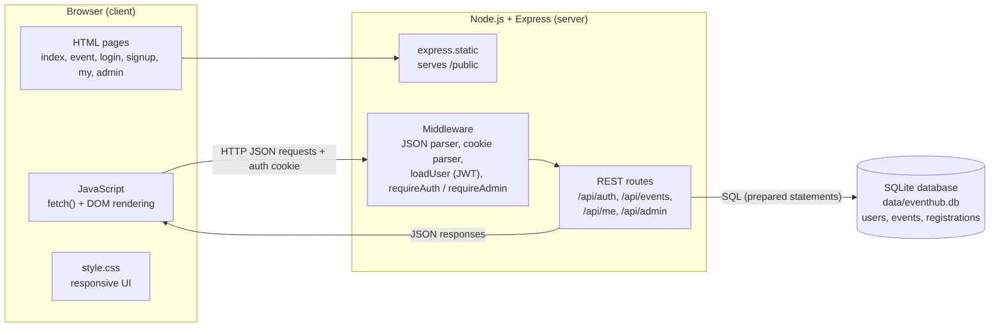

Plain-text view of the same flow:

```
 Browser (HTML/CSS/JS)  --fetch('/api/...')-->  Express server  --SQL-->  SQLite file
        ^                    JSON + cookie       |  middleware  |           (users, events,
        |                                        |  routes      |            registrations)
        +----------------- JSON response --------+--------------+
```

### Folder structure

```
campus-eventhub/
├── package.json            # dependencies and npm scripts (start, dev)
├── server/
│   ├── index.js            # Express app: middleware, routes, static files, error handler
│   ├── db.js               # opens SQLite, creates tables, seeds admin/students/events
│   ├── middleware/
│   │   └── auth.js         # JWT cookie: issueToken, loadUser, requireAuth, requireAdmin
│   └── routes/
│       ├── auth.js         # /api/auth  - signup, login, logout, me
│       ├── events.js       # /api/events - list, details, register/cancel, admin CRUD, registrants
│       ├── me.js           # /api/me    - my registrations
│       └── admin.js        # /api/admin - dashboard statistics
├── public/                 # frontend served by Express
│   ├── index.html  event.html  login.html  signup.html  my.html  admin.html  404.html
│   ├── css/style.css
│   └── js/common.js  events.js  event.js  auth.js  my.js  admin.js
├── screenshots/            # output screenshots used in this report
├── report/report.html      # printable version of this report (source of REPORT.pdf)
└── REPORT.pdf
```

## 6. Database Schema

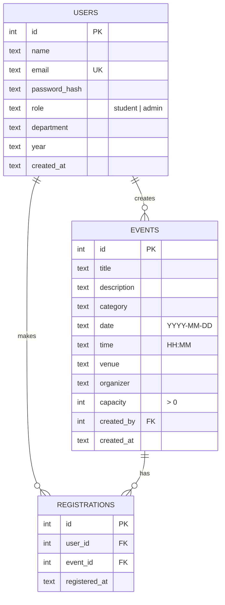

| Table | Column | Type | Constraints |
|---|---|---|---|
| **users** | id | INTEGER | PRIMARY KEY AUTOINCREMENT |
| | name | TEXT | NOT NULL |
| | email | TEXT | NOT NULL, UNIQUE |
| | password_hash | TEXT | NOT NULL (bcrypt hash, never the plain password) |
| | role | TEXT | NOT NULL, DEFAULT 'student', CHECK IN ('student','admin') |
| | department, year | TEXT | optional |
| | created_at | TEXT | DEFAULT datetime('now') |
| **events** | id | INTEGER | PRIMARY KEY AUTOINCREMENT |
| | title, description, category, venue, organizer | TEXT | NOT NULL |
| | date / time | TEXT | NOT NULL (`YYYY-MM-DD` / `HH:MM`) |
| | capacity | INTEGER | NOT NULL, CHECK (capacity > 0) |
| | created_by | INTEGER | REFERENCES users(id) ON DELETE SET NULL |
| **registrations** | id | INTEGER | PRIMARY KEY AUTOINCREMENT |
| | user_id | INTEGER | NOT NULL, REFERENCES users(id) ON DELETE CASCADE |
| | event_id | INTEGER | NOT NULL, REFERENCES events(id) ON DELETE CASCADE |
| | registered_at | TEXT | DEFAULT datetime('now') |
| | (user_id, event_id) | | **UNIQUE** - a student can register only once per event |

`registrations` is the junction table of the many-to-many relationship between users and events. Deleting an event automatically deletes its registrations (`ON DELETE CASCADE`).

## 7. REST API Endpoints

All endpoints are under `/api`, accept and return JSON, and report errors as `{ "error": "message" }` with a suitable HTTP status code.

| Method | Endpoint | Access | Description |
|---|---|---|---|
| POST | `/api/auth/signup` | Public | Create a student account and log in (sets cookie) |
| POST | `/api/auth/login` | Public | Log in with email and password (sets cookie) |
| POST | `/api/auth/logout` | Public | Clear the login cookie |
| GET | `/api/auth/me` | Public | Current user, or `null` if not logged in |
| GET | `/api/events` | Public | List events. Query: `search`, `category`, `from`, `to`, `when=upcoming\|past\|all` |
| GET | `/api/events/categories` | Public | List of allowed categories |
| GET | `/api/events/:id` | Public | One event with `registered_count`, `seats_left`, `is_registered`, `is_past` |
| POST | `/api/events/:id/register` | Logged in | Register for an event (checks seats, duplicates, past date) |
| DELETE | `/api/events/:id/register` | Logged in | Cancel own registration |
| GET | `/api/me/registrations` | Logged in | Events the current user registered for |
| POST | `/api/events` | Admin | Create an event |
| PUT | `/api/events/:id` | Admin | Update an event (capacity cannot go below current registrations) |
| DELETE | `/api/events/:id` | Admin | Delete an event and its registrations |
| GET | `/api/events/:id/registrants` | Admin | Students registered for an event |
| GET | `/api/admin/stats` | Admin | Totals: events, upcoming events, registrations, students |

Status codes used: `200 OK`, `201 Created`, `400 Bad Request` (validation), `401 Unauthorized` (not logged in), `403 Forbidden` (not admin), `404 Not Found`, `409 Conflict` (already registered / event full / email taken).

## 8. How to Run

**Requirements:** Node.js **22.13 or newer** (developed and tested on Node.js 24) - nothing else; SQLite is built into Node.

```bash
git clone https://github.com/chhelu123/campus-eventhub.git
cd campus-eventhub
npm install
npm start
```

Open **http://localhost:3000** in the browser.

- On the first run the database file `data/eventhub.db` is created and filled with the admin account, 5 sample students, 8 events (7 upcoming, 1 past) and some registrations. Event dates are relative to the day you first run it, so the events are always "upcoming".
- Log in as admin with **admin@eventhub.com / admin123** to open the Admin Panel.
- To start again from a clean database, stop the server and delete the `data/` folder.
- Optional environment variables: `PORT` (default 3000), `JWT_SECRET` (change it in production), `DB_PATH`.
- `npm run dev` restarts the server automatically when files change (uses `node --watch`).

## 9. Key Code Snippets with Explanation

### 9.1 Server setup - `server/index.js`

```js
const app = express();
const PORT = Number(process.env.PORT) || 3000;

app.use(express.json({ limit: '100kb' }));   // parse JSON request bodies
app.use(cookieParser());                     // parse the auth cookie
app.use(loadUser);                           // attach req.user when logged in

// REST API
app.use('/api/auth', require('./routes/auth'));
app.use('/api/events', require('./routes/events'));
app.use('/api/me', require('./routes/me'));
app.use('/api/admin', require('./routes/admin'));

// Frontend (HTML/CSS/JS)
app.use(express.static(path.join(__dirname, '..', 'public'), { extensions: ['html'] }));

app.listen(PORT, () => console.log(`Campus EventHub running at http://localhost:${PORT}`));
```

**Explanation:** Express processes every request through a chain of *middleware*. First the JSON body and cookies are parsed, then `loadUser` checks the login cookie. Requests starting with `/api` are handled by the route modules (the REST API); everything else is served from the `public` folder as static HTML/CSS/JS files. The `extensions: ['html']` option lets `/admin` serve `admin.html`.

### 9.2 Database - `server/db.js`

```js
const { DatabaseSync } = require('node:sqlite');
const db = new DatabaseSync(DB_PATH);
db.exec('PRAGMA foreign_keys = ON;');

db.exec(`
  CREATE TABLE IF NOT EXISTS registrations (
    id            INTEGER PRIMARY KEY AUTOINCREMENT,
    user_id       INTEGER NOT NULL REFERENCES users(id)  ON DELETE CASCADE,
    event_id      INTEGER NOT NULL REFERENCES events(id) ON DELETE CASCADE,
    registered_at TEXT    NOT NULL DEFAULT (datetime('now')),
    UNIQUE (user_id, event_id)
  );
`);
```

**Explanation:** `node:sqlite` is SQLite built into Node.js, so no database server or native add-on is needed. Tables are created with `CREATE TABLE IF NOT EXISTS`, so the first run creates them and later runs reuse them. Foreign keys with `ON DELETE CASCADE` and the `UNIQUE (user_id, event_id)` constraint keep the data consistent at the database level too. All queries use **prepared statements** with `?` or `:name` placeholders, which prevents SQL injection.

### 9.3 Authentication - `server/routes/auth.js` and `server/middleware/auth.js`

```js
// Login route
router.post('/login', (req, res) => {
  const email = String(req.body.email || '').trim().toLowerCase();
  const password = String(req.body.password || '');
  const row = db.prepare('SELECT * FROM users WHERE email = ?').get(email);
  if (!row || !bcrypt.compareSync(password, row.password_hash)) {
    return res.status(401).json({ error: 'Invalid email or password.' });
  }
  const { password_hash, created_at, ...user } = row;
  issueToken(res, user);
  res.json({ user });
});

// Middleware
function issueToken(res, user) {
  const token = jwt.sign({ id: user.id, role: user.role }, JWT_SECRET, { expiresIn: '7d' });
  res.cookie('eh_token', token, { httpOnly: true, sameSite: 'lax', maxAge: 7 * 24 * 60 * 60 * 1000 });
}

function requireAdmin(req, res, next) {
  if (!req.user) return res.status(401).json({ error: 'Please log in to continue.' });
  if (req.user.role !== 'admin') return res.status(403).json({ error: 'Admin access only.' });
  next();
}
```

**Explanation:** At sign-up the password is hashed with **bcrypt** (`bcrypt.hashSync(password, 10)`), so the database never stores the real password. At login `bcrypt.compareSync` checks the typed password against the hash. On success the server creates a **JSON Web Token** signed with a secret key containing the user id and role, and stores it in an **httpOnly** cookie, which page JavaScript cannot read (protects against token theft through XSS). On each request `loadUser` verifies the token and sets `req.user`; `requireAuth` and `requireAdmin` guard the protected routes.

### 9.4 A route with business rules - registering for an event (`server/routes/events.js`)

```js
router.post('/:id/register', requireAuth, (req, res) => {
  const event = getEvent(req.params.id, req.user.id);
  if (!event) return res.status(404).json({ error: 'Event not found.' });
  if (event.is_past) return res.status(400).json({ error: 'This event has already taken place.' });
  if (event.is_registered) return res.status(409).json({ error: 'You are already registered for this event.' });
  if (event.seats_left <= 0) return res.status(409).json({ error: 'Sorry, this event is full.' });

  db.prepare('INSERT INTO registrations (user_id, event_id) VALUES (?, ?)').run(req.user.id, event.id);
  res.status(201).json({ message: 'Registered successfully.', event: getEvent(event.id, req.user.id) });
});
```

**Explanation:** `requireAuth` makes sure only logged-in users reach this code. `getEvent` loads the event together with a live `registered_count` (a `COUNT(*)` subquery) and whether this user is already registered. The route then checks the business rules in order - the event exists, it is not in the past, the student is not already registered and seats are left - and only then inserts the registration. It returns `201 Created` with the updated event so the page can refresh the seat count without reloading.

### 9.5 Frontend fetch - `public/js/common.js` and `public/js/event.js`

```js
// Reusable wrapper around fetch()
async function api(path, { method = 'GET', body } = {}) {
  const res = await fetch('/api' + path, {
    method,
    credentials: 'same-origin', // send the auth cookie
    headers: body ? { 'Content-Type': 'application/json' } : {},
    body: body ? JSON.stringify(body) : undefined,
  });
  const data = await res.json().catch(() => ({}));
  if (!res.ok) throw new Error(data.error || `Request failed (${res.status})`);
  return data;
}

// Register button on the event details page
async function act(method, btn, okMsg) {
  btn.disabled = true;
  try {
    const { event } = await api(`/events/${eventId}/register`, { method });
    toast(okMsg);                 // "You are registered! See you there."
    render(event, currentUser);   // re-draw seats and button
  } catch (err) {
    toast(err.message, 'error');  // e.g. "Sorry, this event is full."
    btn.disabled = false;
  }
}
```

**Explanation:** Every page talks to the server through the small `api()` helper. It sends JSON with `fetch()`, includes the login cookie, converts the JSON response, and turns any non-2xx response into a JavaScript error carrying the server's message. On the event page the Register button calls `POST /api/events/:id/register` (or `DELETE` to cancel); the returned event is used to re-render the page immediately and a toast message shows the result.

### 9.6 Client-side form validation - `public/js/auth.js`

```js
const ok = validateForm(signup, {
  name: [[(v) => v.length >= 2, 'Please enter your full name']],
  email: [[(v) => v, 'Email is required'], [isEmail, 'Enter a valid email address']],
  department: [[(v) => v, 'Choose your department']],
  year: [[(v) => v, 'Choose your year']],
  password: [[(v) => v.length >= 6, 'Password must be at least 6 characters']],
  confirm: [[(v, f) => v === f.password.value, 'Passwords do not match']],
});
if (ok) submitWith(signup, '/auth/signup', { /* form values */ });
```

**Explanation:** Each field has a list of rules (a test function and a message). `validateForm` runs them, highlights invalid fields in red and shows the message under the field, so mistakes are caught instantly without a server round-trip. The server repeats the important checks, because client-side validation alone can be bypassed.

## 10. Output

All screenshots were taken from the running application (headless Chrome, 1366 x 850) while performing the actions described.

### 10.1 Home page - list of upcoming events
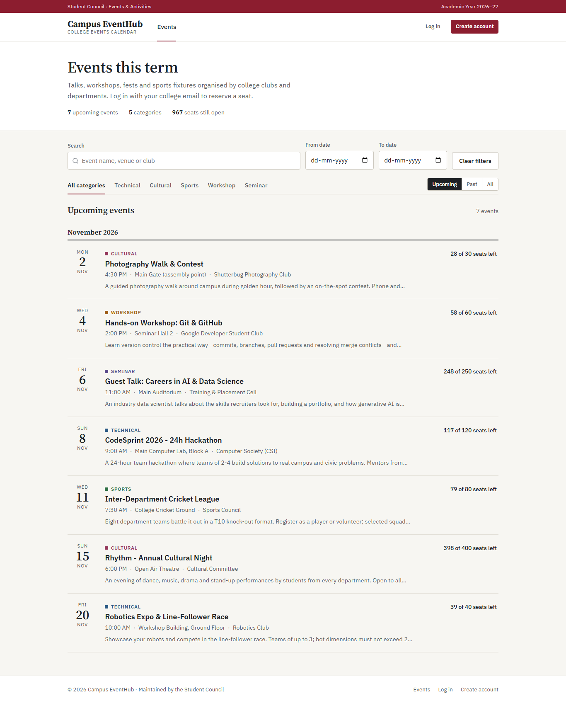

### 10.2 Search and category filter ("hack" in Technical)
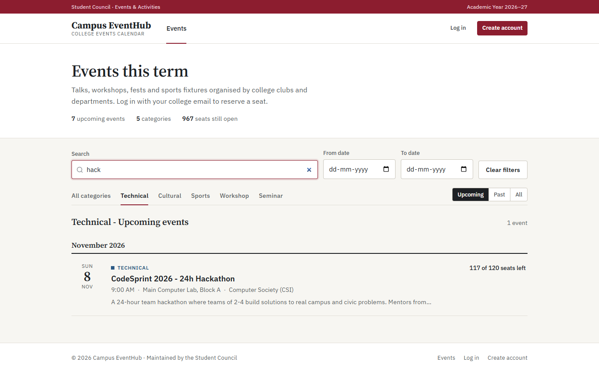

### 10.3 Sign-up form - client-side validation errors
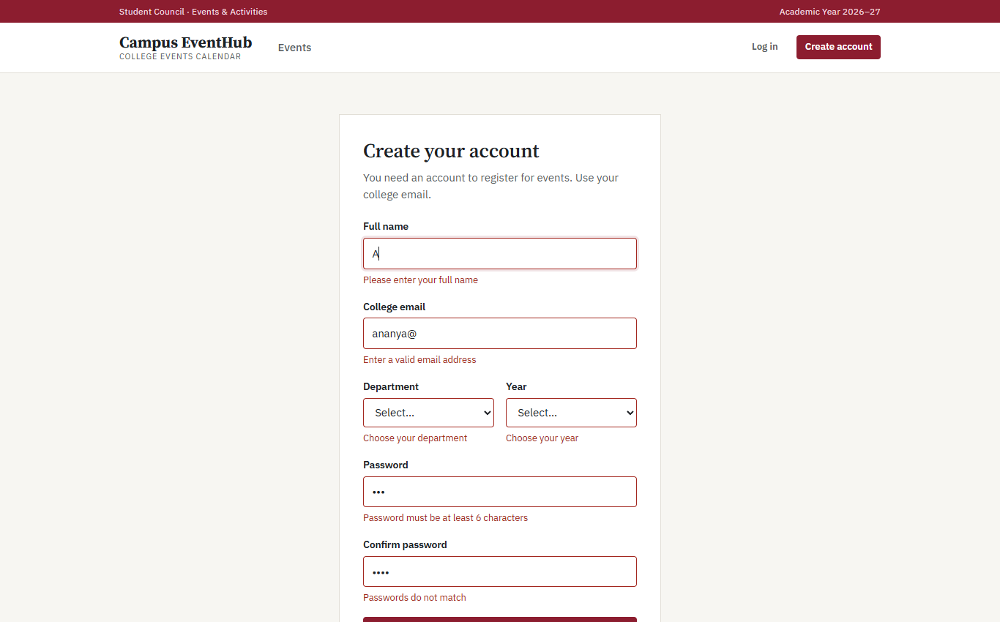

### 10.4 Sign-up form - new student filled in
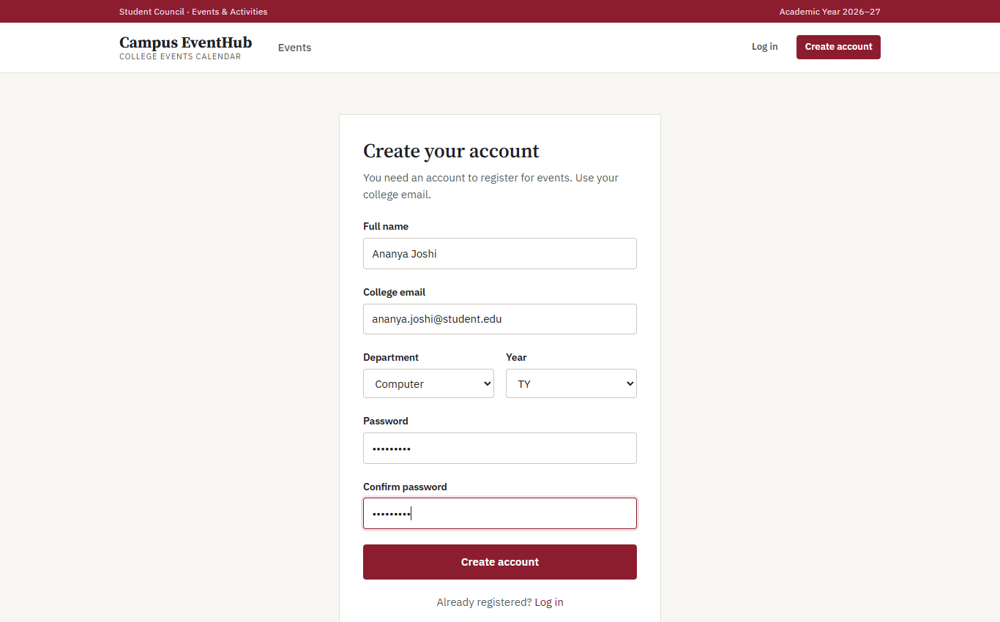

### 10.5 Event details (logged in, before registering)
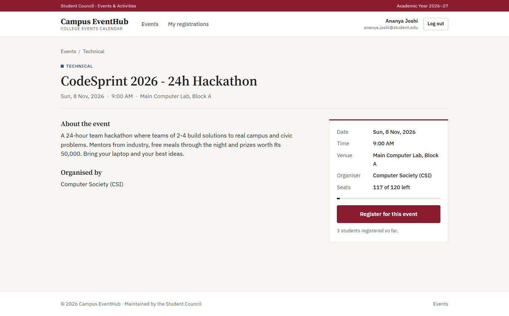

### 10.6 After clicking "Register now"
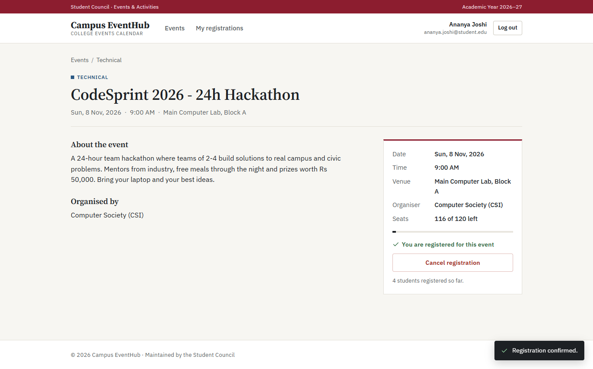

### 10.7 Home page when logged in - "Registered" tags
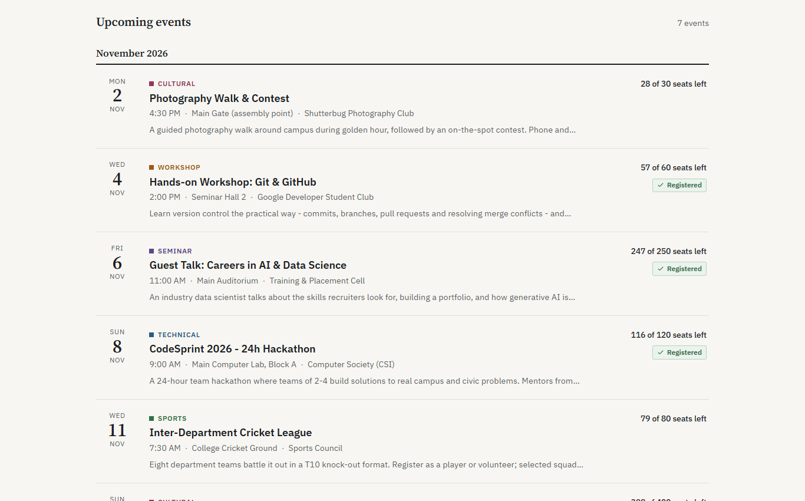

### 10.8 My Registrations
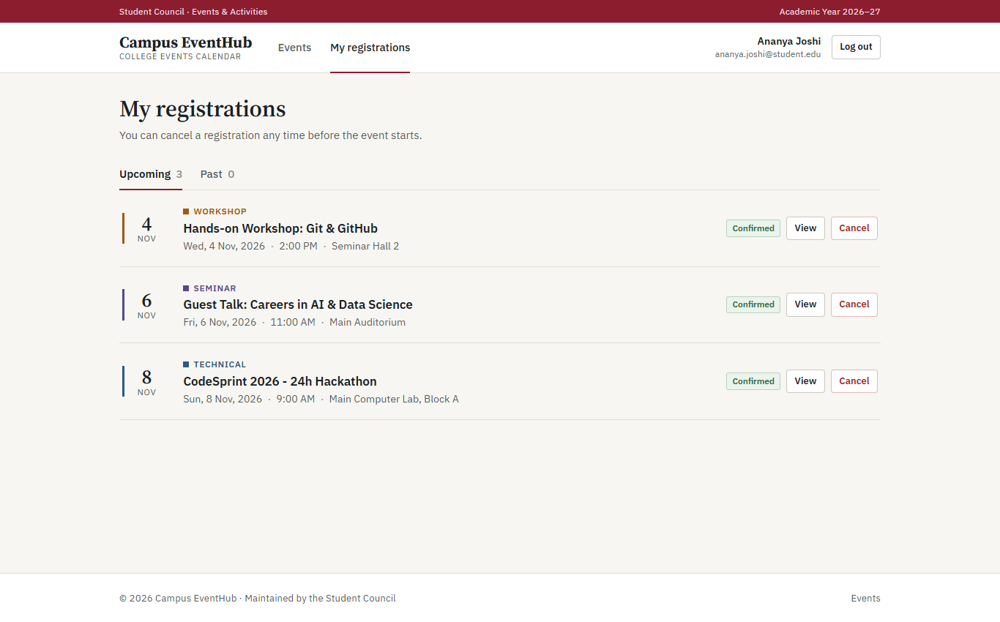

### 10.9 Login page (admin credentials)
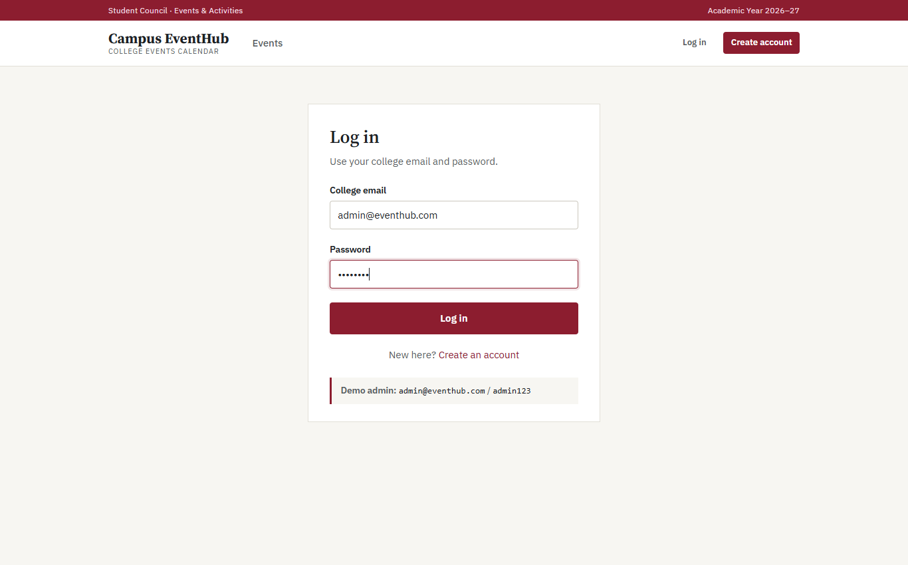

### 10.10 Admin panel - statistics and events table
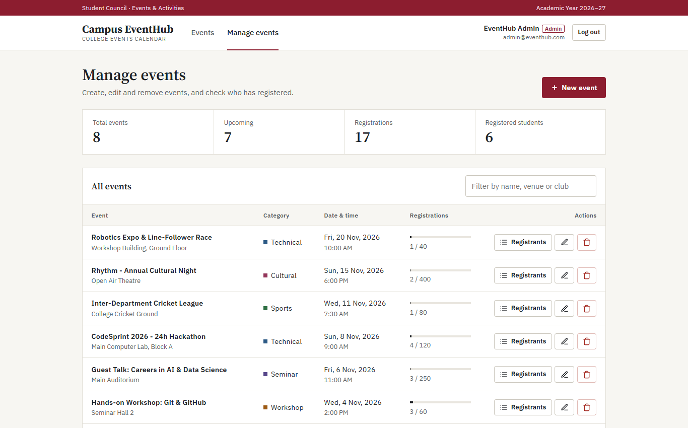

### 10.11 Admin - create a new event
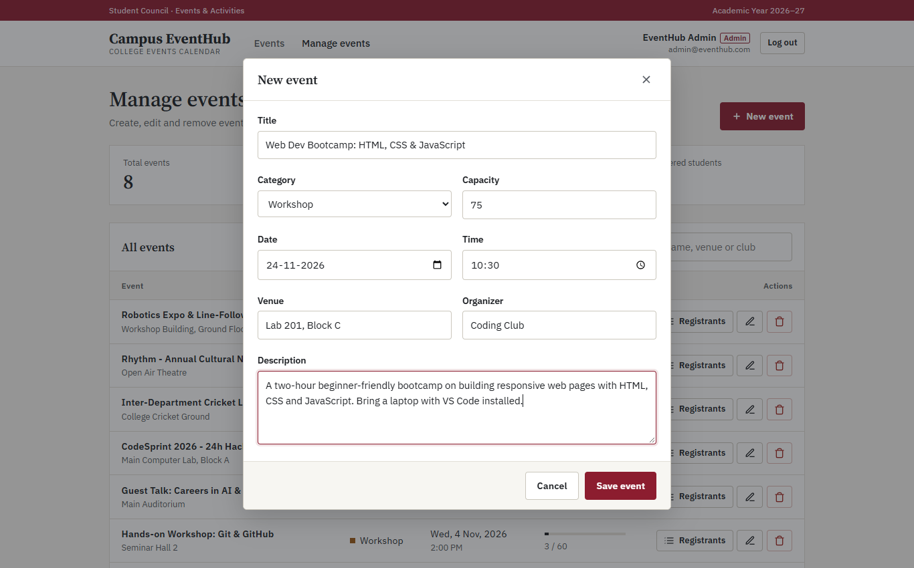

### 10.12 Admin - event created (top row of the table)
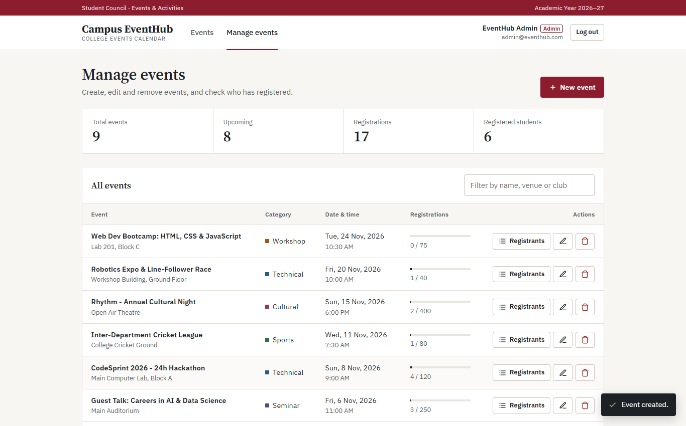

### 10.13 Admin - registrant list for an event
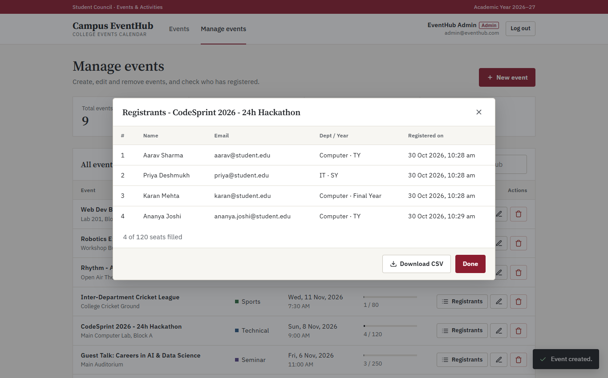

### 10.14 New event visible to students (Workshop filter)
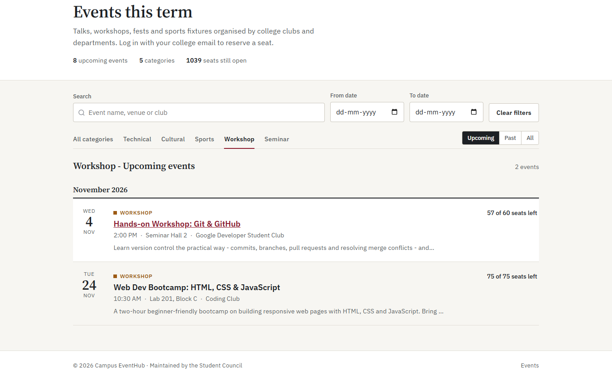

### 10.15 Responsive layout on a mobile screen (390 px wide)
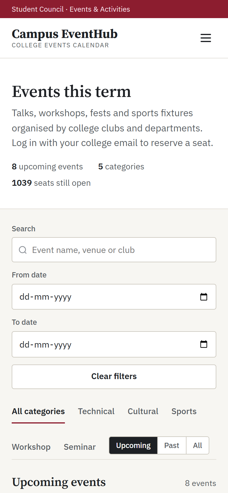

### 10.16 REST API tested with curl
Raw text: [screenshots/api-sample.txt](screenshots/api-sample.txt)

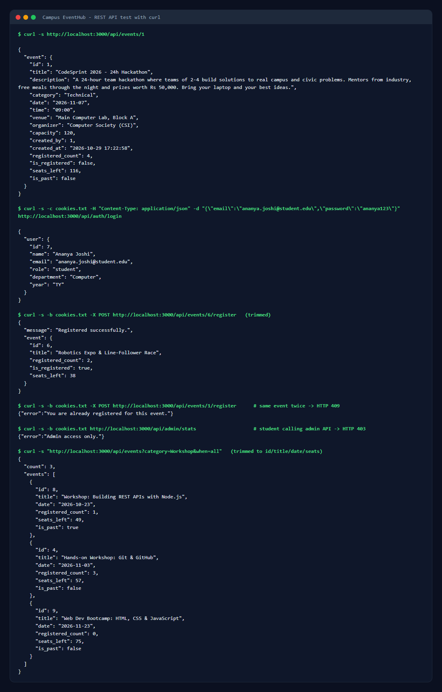

## 11. Conclusion

Campus EventHub meets the goal of the mini project: it is a complete full-stack web application in which the browser (HTML, CSS, JavaScript) communicates with a Node.js/Express REST API that stores data in an SQLite database. Working on it covered the main topics of web programming - semantic HTML forms, responsive CSS layouts with Flexbox and Grid, DOM manipulation and `fetch()` in JavaScript, HTTP methods and status codes, REST API design, server-side validation, relational database design with keys and constraints, and secure authentication with hashed passwords and cookies.

**Possible future enhancements:** email confirmation of registrations, event posters (image upload), a waiting list when an event is full, QR-code tickets for attendance, and deployment to a cloud host with HTTPS.
